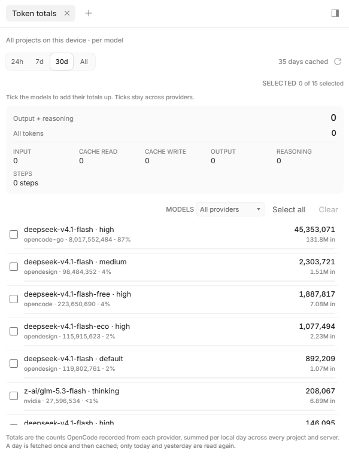

# Token Totals

Per-model token totals across **every project on the device**, with the models you tick added up together.



Run History shows only the last 500 turns it happened to observe, and only while the plugin was loaded. This panel instead asks OpenCode's own stats endpoint for each local day, caches that day, and never reads it again — so the first run reads the whole history and every later look costs two requests.

Everything stays local. No account, no network calls beyond the OpenCode server already running on your machine.

## Install

Add the plugin to your global config, alongside whatever you already have:

```jsonc
// ~/.config/opencode/opencode.json
{
  "plugins": [
    "@kyan-plugins/run-meter",          // optional, unrelated
    "/path/to/token-totals"
  ]
}
```

OpenCode loads a local directory by path. Build it once first:

```bash
cd /path/to/token-totals
bun install
bun run build
```

Then open a session, click **+** in the side panel, and choose **Open token totals**. The tab is titled **Token totals**.

### No bun? Use the CLI that ships with the desktop app

The desktop app bundles bun as its own CLI, so a machine without node or bun can still build:

```powershell
$env:BUN_BE_BUN="1"
$cli = Join-Path $env:LOCALAPPDATA "Programs\ai.opencode.desktop\resources\opencode-cli.exe"
& $cli run build
```

```bash
# macOS / Linux
BUN_BE_BUN=1 /Applications/OpenCode.app/Contents/Resources/opencode-cli run build
```

`opencode-cli.exe` is bun with extra subcommands; `BUN_BE_BUN=1` makes `run` and `install` behave as plain bun. Drop the variable when you want its `api` subcommand instead.

## Using it

### Time range

`24h` · `7d` · `30d` · `All` — a switch under the scope line. `All` reaches back to the earliest day the server reports any recording for.

### Provider filter

The **Models** header carries a provider dropdown, listing every provider present in the chosen range with its model count:

```
All providers
opencode-go · 1
opendesign · 6
nvidia · 2
```

The filter narrows **only the list below it**. It does not change the numbers:

- The **Selected** card always totals every ticked model, across providers, so ticking one model from two providers adds them.
- **Select all** adds every model the filter shows and keeps selections from other providers.
- **Clear** removes only the models the filter shows, leaving other providers' ticks alone.
- Ticks survive switching providers and switching ranges; a tick drops out only when that model stops appearing in the range.

### Models list

Each row is one provider/model/variant with a checkbox:

- `Output + reasoning` — what the model generated, the main number
- `input` — fresh input, compact form
- A bar showing the model's share of all generated tokens in the range
- `provider · all tokens · share%` underneath the name

Rows sort by generation, largest first.

### Selected card

Two totals, deliberately kept apart:

- **Output + reasoning** — what the models produced.
- **All tokens** — all five buckets, each counted once.

Then the five buckets separately (`Input`, `Cache read`, `Cache write`, `Output`, `Reasoning`) and the step count.

### Toolbar

- **Refresh** refetches the whole history from the earliest recorded day. Use it after clearing the cache, or if a day looks wrong.
- The line beside it reads `N days cached` and, on hover, when the data was last read.
- A progress row appears during a long first run: `Reading Nov 3 · 12/66`.

## How the cache works

The unit is **one local calendar day**.

1. The first run makes one all-time stats call to learn the earliest recorded day, then fetches **one stats call per day** from that day to today.
2. Each day is stored as `{ date, fetchedAt, models[] }`, where `models[]` carries the per-model `steps / input / output / reasoning / cacheRead / cacheWrite`.
3. A finished day never changes, so afterwards it is only read from the cache.
4. A routine look refetches **today and yesterday** — two requests. Yesterday is included because a turn can start before midnight and finish after.
5. Every request covers a whole local day, `[day 00:00, next day 00:00)`, and a later fetch **replaces** that day's row. A day can therefore be refetched at any time without counting its figures twice.
6. Each day is written to the store as it arrives, so a long first run survives closing the window or reloading it.

Cost of a first run is one request per day since the earliest recording. On a 35-day history that is 36 requests and finishes in seconds; afterwards the panel costs two per look, and nothing at all while it is closed.

Settings › **Token totals** has one action: **Clear cached totals**, which deletes every day and refetches the whole history.

## Token definitions

OpenCode records five buckets per assistant step. The panel shows each one separately and never mixes them:

| Field | Meaning |
| --- | --- |
| `input` | Fresh input tokens, cache misses only |
| `cacheRead` | Input tokens served from the provider cache |
| `cacheWrite` | Input tokens written to the provider cache |
| `output` | Visible output tokens, reasoning excluded |
| `reasoning` | Reasoning tokens |

Two sums are shown, on purpose kept apart:

- **Output + reasoning** — what the model generated.
- **All tokens** — all five buckets, each counted once. Dominated by cache reads, so it is not a meaningful "spend".

For comparison with the OpenCode Go console: its `input` column is `input + cache_read + cache_write` and its billed `output` includes reasoning. Compare the buckets side by side rather than a single total.

Counts on a paid Go allowance will come out **higher** here than in the console when the machine has used the same models elsewhere, and **lower** when usage happened on another machine or before this cache existed. The panel only knows what this device recorded.

## What is and is not counted

- Totals are the counts OpenCode recorded from each provider, per assistant step, for **all projects and all subagents on this server**. Nothing is estimated or tokenized locally.
- `cost` is not shown. On Go it is recorded locally as `0`, so any figure would be invented.
- Only days with recorded activity appear in the cache; empty days store nothing.
- The day boundary is the **local calendar**, matching what the stats endpoint does with its own `from`/`to` bounds.
- Every server the app lists is queried, and their rows for the same day are summed.

## Files

| File | Role |
| --- | --- |
| `src/store.ts` | Effect schemas for the cached day rows |
| `src/stats.ts` | Day keys, day bounds, day merging, aggregation, provider grouping |
| `src/refresh.ts` | The incremental fetch loop and per-day write |
| `src/panel.tsx` | The side panel tab: range switch, provider filter, checkboxes, selected totals |
| `src/gui.tsx` | Registration: panel tab, `+` menu item, settings page, style |
| `src/i18n/en.ts` | Copy for every string |
| `scripts/validate.ts` | Acceptance check, see below |

## Validation

`scripts/validate.ts` runs the real refresh loop against a live server, then compares the cached sum with a single whole-range stats call. The two must match on all six fields, and it prints the request count so the caching promise is visible:

```
cli: opencode-cli.exe (auto-detected)
first run: 35 days fetched in 36 requests
models cached: 15 (server reports 15)
  steps:      cached=61163      server=61163      delta=0
  input:      cached=163171258  server=163171258  delta=0
  output:     cached=24134999   server=24134999   delta=0
  reasoning:  cached=28806679   server=28806679   delta=0
  cacheRead:  cached=8512450738 server=8512450738 delta=0
  cacheWrite: cached=0          server=0          delta=0
second look: 2 days refetched in 2 requests
third look: 2 requests, totals unchanged=true
day tiling: contiguous
OK: the day cache reproduces the server's whole-range totals exactly
```

Run it with the CLI's `api` subcommand available (no `BUN_BE_BUN`):

```bash
bun run validate
```

It locates the desktop CLI itself: `OPENCODE_CLI` when set, else the usual install location per platform, else `opencode-cli` on the PATH. It prints which one it used, and exits with a message pointing at `OPENCODE_CLI` when none is found.

The check exits non-zero and prints `MISMATCH: <fields>` if any bucket drifts, or `day tiling: GAP ...` if the local-midnight boundaries ever fail to tile (the failure mode a daylight-saving change could cause). That makes it a regression guard after a server or client upgrade.

## Compatibility

Built against `@opencode/plugin` 2.3.0 and `@opencode/client` 2.3.0, and type-checked against them. It reads `client.experimental.session.stats({ from, to, tools: "none" })`, the endpoint `GET /api/experimental/session/stats`. That endpoint is marked experimental upstream; if it moves, only this panel stops working, and nothing else in the app is affected.

## License

MIT
